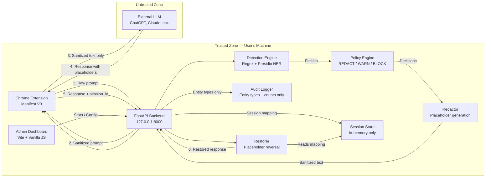

# PII-Shield — Architecture

> IBM Z Datathon 2026 — "AI Secured: Innovation Without Exposure"
> Version: 0.2.0

---

## System Overview

PII-Shield is a **local-first privacy guardrail** that intercepts prompts
sent to external LLMs, detects sensitive information using layered detection
engines, and replaces it with deterministic placeholders before the text
crosses the trust boundary. After the LLM responds, placeholder values are
restored locally so the user sees the original context.

**Core invariant:** Original sensitive values never leave the local machine.

---

## Data-Flow Diagram



---

## Component Details

### Detection Engine (`backend/engine/`)

Two-pass detection with deduplication:

| Pass | Engine | Catches | Confidence |
|------|--------|---------|------------|
| 1 — Regex | `regex_patterns.py` | SSN, credit card, email, phone, IP, AWS key, JWT, Aadhaar, PAN, passwords | 0.85–1.0 |
| 2 — NER | `presidio_wrapper.py` | Person names, locations, organizations, dates | 0.5–0.95 |

Overlapping spans are deduplicated by keeping the higher-confidence detection.
When scores tie, regex is preferred (more precise for structured data).

### Redaction Engine (`backend/engine/redactor.py`)

- Generates deterministic placeholders: `[ENTITY_TYPE_N]`
- Same value → same placeholder (idempotent)
- Right-to-left replacement preserves character offsets
- Returns a `mapping: dict[str, str]` (placeholder → original)

### Session Store (`backend/utils/session.py`)

- **In-memory only** — never written to disk
- UUID4 session IDs (122 bits of entropy)
- TTL-based auto-expiry (default: 1 hour)
- Thread-safe (Lock-protected)
- Single-use: mapping is deleted after restoration

### Policy Engine (`backend/policy/rules.py`)

Three built-in profiles:

| Profile | Behaviour |
|---------|-----------|
| `default` | Redacts structured PII (SSN, CC, keys). Warns on dates, passport numbers. |
| `strict` | Redacts everything. **Blocks** SSN, credit card, Aadhaar. |
| `permissive` | Redacts only high-risk structured data. Warns on email/phone. Skips locations. |

### Audit Logger (`backend/audit/logger.py`)

- Bounded ring buffer (default: 10,000 events)
- **Never receives** raw text, PII values, or mappings
- Records only: entity types, counts, policy profile, action, timestamp

### Chrome Extension (`extension/`)

- Manifest V3 with service worker architecture
- Popup: backend health, toggle, stats
- Demo page: full analyze → sanitize → restore workflow
- Host permissions restricted to `http://127.0.0.1:8000/*`
- Content Security Policy: `script-src 'self'; object-src 'self'`

### Admin Dashboard (`dashboard/`)

- Vanilla HTML/CSS/JS served by Vite
- Proxies `/api/*` to FastAPI backend
- Four tabs: Overview, Policy, Audit Events, Quick Test
- No external dependencies beyond Vite dev server

---

## Security Boundaries

```
┌─────────────────────────────────────────────────────────┐
│ TRUSTED ZONE (User's Local Machine)                     │
│                                                         │
│  Chrome Extension ←→ FastAPI Backend (127.0.0.1:8000)   │
│                          │                              │
│                   Session Store (RAM)                   │
│                   Audit Logger (RAM)                    │
│                   Dashboard (localhost:5173)             │
└─────────────────────────┬───────────────────────────────┘
                          │ TRUST BOUNDARY
                          ▼
┌─────────────────────────────────────────────────────────┐
│ UNTRUSTED ZONE                                          │
│   External LLM APIs (receive sanitized text ONLY)       │
└─────────────────────────────────────────────────────────┘
```

---

## Technology Stack

| Layer | Technology |
|-------|-----------|
| Backend | Python 3.11+, FastAPI, Pydantic v2, uvicorn |
| Detection | Custom regex engine, Microsoft Presidio, spaCy NLP |
| Extension | Chrome Manifest V3, vanilla JS |
| Dashboard | Vanilla HTML/CSS/JS, Vite |
| Testing | pytest, pytest-asyncio, httpx (TestClient) |
